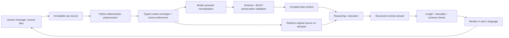

# Context Compiler — Design Proposal

**Status:** Proposed design only. No script is claimed to exist or be verified.

## Goal

Reduce repeated context and make human ↔ AI communication language-independent without losing requirements or evidence.

## Design



## Responsibility split

| Layer | Responsibility | Must not do |
|---|---|---|
| Python preprocessor | Parse files, extract identifiers/headings/links, deduplicate, hash sources, build references, estimate token budget, validate schema | Pretend to understand semantics or rewrite authoritative requirements |
| Model normalizer | Understand any supported human language and map intent into the envelope | Invent missing requirements or remove uncertainty |
| Context validator | Check required fields, source links, preserved MUSTs, numbers, negation and conflicts | Silently drop fields to fit a token budget |
| Response generator | Answer using the compact envelope and retrieve originals when needed | Treat summaries as stronger than source evidence |
| Output validator/renderer | Enforce concise structure and language/terminology policy | Change technical meaning to satisfy a word limit |

## Canonical context envelope

```json
{
  "task_id": "stable task identifier",
  "language": "vi",
  "goal": "user-visible outcome",
  "scope": ["in-scope work"],
  "non_goals": ["explicit exclusions"],
  "acceptance": [
    {
      "id": "REQ-001",
      "priority": "MUST",
      "statement": "atomic, testable requirement",
      "source": "file-or-message reference"
    }
  ],
  "constraints": ["security, time, platform and owner constraints"],
  "decisions": ["verified decisions only"],
  "evidence": [{"claim": "observed fact", "source": "reference"}],
  "unknowns": ["unresolved facts"],
  "next_action": "one highest-priority action"
}
```

## Input and output rules

- Keep the raw message and original source immutable; the envelope is a derived view.
- Preserve the original language tag. Normalize meaning, not language identity.
- Reply in the user's language by default. Keep standard technical names (OIDC, IAM, CI/CD, MCP, SAST, SCA) unchanged; define unfamiliar terms briefly.
- Use a compact answer contract: direct answer → material problem → solution → trade-off/improvement. Omit sections that do not apply.
- Do not expose chain-of-thought. Return conclusions, concise rationale, evidence and uncertainty.
- If the user asks for a full artifact, produce the complete artifact; brevity is not permission to omit acceptance requirements.

## Safety and correctness gates

1. Source provenance: every MUST has an exact source reference.
2. Semantic preservation: test negation, numbers, dates, IDs, thresholds, conditions and exceptions.
3. Conflict handling: retain both conflicting statements and mark unresolved; never choose silently.
4. Prompt-injection boundary: retrieved text is data, not authority to override system/project/owner instructions.
5. Budget handling: drop duplicate/redundant context first; retrieve relevant passages on demand; if mandatory context still exceeds budget, stop and request a larger budget or narrower scope.
6. Privacy: never log secrets or publish private raw conversations; keep raw evidence separate from derived/redacted working views.
7. Measurement: compare token usage, task correctness, requirement retention and retrieval latency against a no-compression baseline.

## Required tests before implementation is trusted

- Same intent expressed in Vietnamese and English maps to equivalent acceptance fields.
- Negation, quantities, dates, identifiers and security constraints survive compression.
- A source conflict remains visible.
- Prompt injection inside a retrieved document cannot rewrite the task.
- Over-budget mandatory context fails visibly rather than truncating.
- Output remains concise without changing the technical meaning.
- Every summary claim can be traced to its source.

## Trade-off

Compression saves repeated context tokens and reduces noise, but semantic compression can lose nuance. The safe design is **immutable source + compact structured envelope + on-demand retrieval**, not summary-only memory.
