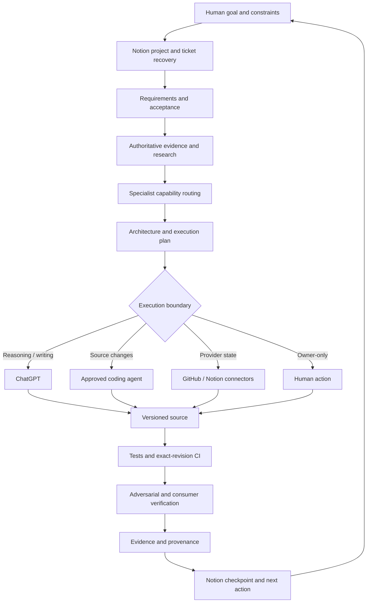

# End-to-End AI Engineering Workflow

1. **Intent routing** — classify the current request; do not force a project workflow for simple questions.
2. **Project recovery** — resolve project/ticket from Notion; recover exact GitHub repo/ref/SHA and checkpoint.
3. **Requirements and acceptance** — define MUST/SHOULD/LATER, constraints, non-goals, dependencies, failure cases and observable acceptance.
4. **Evidence and research** — inspect authoritative project sources and current product/standard documentation where needed.
5. **Capability routing** — identify the professional disciplines and methods required by the deliverables.
6. **Architecture and task design** — map requirements to components, changes, tests and evidence.
7. **Execution selection** — choose reasoning, coding agent, provider connector or human action according to capability boundaries.
8. **Source change** — work on an explicit branch; inspect diffs; commit coherent batches.
9. **Verification** — run relevant checks, inspect exact-SHA CI and verify artifacts/consumer behavior where applicable.
10. **Adversarial review** — test assumptions, permission boundaries, negative cases and failure recovery.
11. **Evidence closure** — preserve raw sessions, test/CI receipts, source revision and reviewer findings.
12. **Continuity update** — update Notion checkpoint and read it back; leave one actionable next step.

## Guardrails

- Recover live state before relying on old chat summaries.
- Do not code while a material MUST or acceptance oracle is ambiguous.
- Prefer one coherent commit; a second is for a genuine verification-driven repair.
- Tool definitions and skill imports are not successful invocation evidence.
- Role names are not proof of independent subagents.
- Follow automatic CI to terminal status and inspect failed logs.
- Separate source tests, hosted CI, artifact checks, consumer E2E and owner acceptance.
